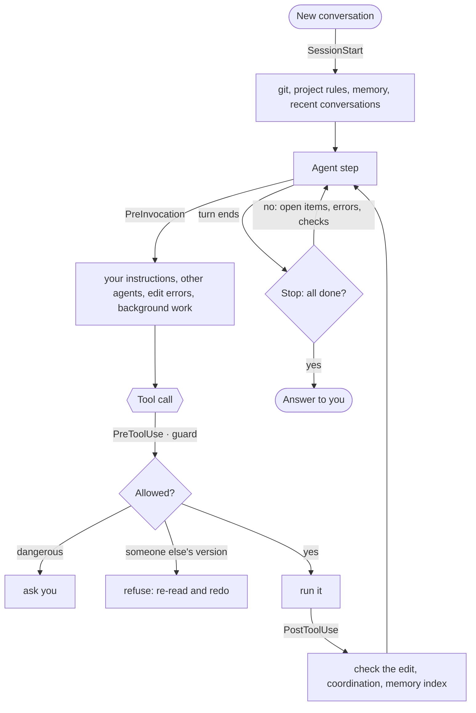

<div align="center">


# Antigravity Plus

**Claude Code's working discipline — for Google Antigravity agents**

Memory across conversations · a guard against dangerous commands · several agents on one project ·<br>
every edit checked · an agent that finishes the job

[](https://github.com/stxrmik/antigravity-plus/actions/workflows/tests.yml)
[](LICENSE)


[Русский](README.md) · **English**

</div>

---

One plugin: 20 commands, 7 subagents, 6 hooks and working rules. One command installs it; the whole plugin is turned
on and off on Antigravity's plugin page. Python standard library only, no dependencies.

## Why

| Without it | With Antigravity Plus |
|---|---|
| "Don't push anything" gets buried under hundreds of steps and context compaction | Your messages come back before each step, and the guard won't let the agent break the ban |
| Every conversation starts from scratch | Memory about you and the project (shared with Claude Code), `/handoff` and "continue" |
| `rm -rf ~`, `git reset --hard`, `cat .env` go through without a question | The guard stops what can't be undone and keeps secrets out of the conversation |
| Two agents on one project overwrite each other's edits | No writing over a version of a file the agent hasn't seen: it re-reads and redoes the edit itself |
| The agent starts a subagent and waits, doing nothing | Independent parts go to subagents in one step while the agent does its own part |
| The agent stops halfway, or "verifies" with a command that just prints "ok" | The Stop hook sends it back to finish `task.md`, run the tests and look at the UI |
| A syntax error surfaces three steps later | Every edit is checked right away: Python, JS, Swift, shell, JSON, YAML… |
| "Do you want me to…?" for every small step | The agent creates the git repository and `AGENTS.md` itself; one "yes" grants full access |

## Install

You need **Google Antigravity 2.x**, **Python 3.8+** and **git**. `/ui-check` also needs Chrome, Chromium, Edge or
Brave.

**macOS and Linux**

```bash
git clone https://github.com/stxrmik/antigravity-plus.git
cd antigravity-plus
./install.sh
```

**Windows** (PowerShell or cmd)

```powershell
git clone https://github.com/stxrmik/antigravity-plus.git
cd antigravity-plus
.\install.cmd
```

Restart Antigravity after the first install. The installer checks that Antigravity loaded the plugin and that the
hooks work; `/doctor` does the same inside Antigravity.

- **Update:** `git pull`, then the same install command.
- **Uninstall:** `./install.sh --uninstall` (Windows: `.\install.cmd --uninstall`). Memory and settings stay;
  `--uninstall --purge` removes them too. Claude Code's memory in `~/.claude` is never touched.

## Features

### 🧠 Memory and continuing work
- The agent remembers what matters about you and the project — how you like to work, corrections, decisions,
  servers, links — and sees it in every new conversation. It says so with a `💾` line.
- Project memory lives in the same folder as **Claude Code**'s auto-memory: what one learns, the other knows.
- `/handoff` saves where a conversation stands: goal, done, left, restrictions. In a new conversation, "continue"
  picks up from there — even from a Claude Code session that ran out of quota.
- At the start of a conversation the agent sees the git context, the project's rules and the three latest
  conversations.

### 🛡️ Safety
- **The guard** stops what can't be undone: `rm -rf` on broad paths, `git reset --hard`, force-push, `DROP TABLE`,
  `curl | sh`, `sudo`, `terraform destroy`… On Windows: `Remove-Item -Recurse -Force C:\`, `iwr … | iex`, `format`,
  autostart through the registry and Task Scheduler.
- **Bans from the conversation hold**: after "don't push anything", push, deploys and uploads wait for your "yes".
- **Secrets stay out of the conversation**: `cat .env`, private keys, `env`, `Get-Content .env` don't run — the
  agent gets a safe way instead. A token in a file git would commit gets a warning.
- **The agent can't widen its own permissions**: Antigravity's permission settings, MCP servers, secret protection
  and the plugin itself change only with your confirmation, even with full access.

### 🤝 Several agents on one project
- An agent can't write over a version of a file it hasn't seen — one another agent, Claude Code or you changed.
  The guard refuses and says who changed it; the agent re-reads and redoes its edit.
- Before each step the agent sees who else is working on the project and on which files, and can coordinate.
- `/commit` takes only the agent's own files, and `/deploy` holds a lock so two agents never deploy at once.

### ⚡ Parallel work
- The agent decides on its own what to hand to subagents: a broad code search to `explorer`, docs and APIs to
  `researcher`, a separate part of the implementation in its own files to `worker`, tests and review. It launches
  them in one step and starts its own part right away.
- While subagents and long commands run in the background, the agent neither idles nor polls them: before each step
  it sees who is busy with what and keeps working. Results arrive by themselves, and the Stop hook won't let it end
  a turn with "Waiting…" while work is left.
- A `task.md` plan with three or more items is the cue to sort out what can run in parallel; three rounds of web
  search in a row are the cue to hand the research to `researcher`. The agent re-checks a `worker`'s report before
  building on it.
- `/parallel` does the same on request, with brief templates; for four or more similar pieces the agent uses
  Antigravity's built-in `run_workflow`.

### ✅ Quality
- Every edit is checked right away: Python, JS, Swift, shell, JSON, YAML, Ruby, plist and XML syntax, plus the
  project's linters (ruff, eslint, swiftlint, shellcheck). The agent sees the error before its next step.
- The Stop hook won't let it end a turn with a syntax error, with open `task.md` items, without checking changed
  code, or without looking at changed UI.
- After a substantial change the agent runs `/review` itself: `code-reviewer` and `security-auditor` in parallel,
  with findings double-checked.

### 🚀 Autonomy and full access
- In a project without git, the agent creates a repository before its first change: a `.gitignore` for the stack,
  the current state as the first commit, with secrets, databases and files over 50 MB kept out. Nothing leaves your
  computer.
- In a project without rules it runs `/init` and writes `AGENTS.md`; rules you state get written down too.
- **Full access** with one "yes": from then on the agent runs `/commit`, `/pr`, `/deploy` and the rest without
  asking. Irreversible actions, your bans and its own permissions still ask.

### 📊 Token usage
- `/usage`: tokens, cache, context fill, API-equivalent cost, per-turn and per-subagent breakdown, HTML report.
- A live side panel refreshes every 3 seconds: cost, Antigravity's 5-hour and weekly limits, context fill, the most
  expensive calls, and all conversations for today and the last 7 days (its UI is in Russian for now).

## Commands

Commands are skills: the agent opens the right one as soon as a request fits. Asking in your own words counts the
same: "commit this" is `/commit`, "check the code" is `/review`.

| Command | What it does | The agent runs it itself |
|---|---|---|
| `/parallel` | split a task into independent parts and hand them to subagents, working in parallel | ✅ when there are 2+ independent parts |
| `/review` | review of the change by two subagents, findings double-checked | ✅ after substantial changes |
| `/security-review` | audit of the branch with exploitability checks | ✅ when a change touches auth, secrets, payments |
| `/ui-check` | screenshots at phone and laptop width, console errors, heavy effects | ✅ after UI changes |
| `/git-init` | a git repository with a safe first commit | ✅ before the first change in a project without git |
| `/init` | `AGENTS.md`: commands, architecture, conventions | ✅ in a project without rules |
| `/remember` | a rule into `AGENTS.md`, `.agents/rules` or memory | ✅ when you state a rule |
| `/handoff` | where the conversation stands, to continue in a new one | ✅ when work remains |
| `/memory` | what the agent remembers; forget, clean up, settings | ✅ memory search |
| `/settings` | what is set where; MCP servers and plugin settings | ✅ viewing |
| `/usage` | token usage and cost, a link to the side panel | ✅ when you ask about usage |
| `/doctor` | the plugin's self-check | ✅ when something misbehaves |
| `/deploy` | what would ship and how risky it is; deploy with backup, health check and rollback | the check ✅, the deploy 🔑 |
| `/commit` | logical commits in the repo's style, without secrets or junk | 🔑 |
| `/pr` | a PR with all the branch's commits and a description | 🔑 |
| `/fix-issue` | issue → branch → reproduce → fix with a test → commit → PR | 🔑 |
| `/simplify` | reuse and simplification in the changed code | 🔑 |
| `/hooks` | the project's own automation in `.agents/hooks.json` | 🔑 |
| `/standup` | what got done today or this week across projects | on request |
| `/export` | the conversation as Markdown, secrets hidden | on request |

🔑 — on your request or with full access. Subagents: `explorer` (fast search on Flash), `researcher` (docs and APIs,
on Flash), `worker` (a part of the implementation in its own files), `code-reviewer`, `security-auditor`,
`debugger`, `test-writer`.

## How it works



| Event | Hook | What it does |
|---|---|---|
| SessionStart | `session_start.py` | git context, project rules (and `CLAUDE.md`), memory, recent conversations, project setup hints |
| PreInvocation | `instructions.py` | your messages after a new message, after compaction and every ~30 steps; edit errors; other agents; what runs in the background and what to do meanwhile |
| PreToolUse | `guard.py` | dangerous commands, secrets, other agents' file versions, bans from the conversation, full access |
| PostToolUse | `check_edit.py`, `memory_sync.py` | edit checks, coordination, memory index |
| Stop | `stop.py` | open items (including those it can do while subagents are busy), syntax errors, verification, review, UI, project setup |

## Details

<details>
<summary><b>🧠 Memory</b></summary>

| Where | What | Folder |
|---|---|---|
| personal | about you, for every project | `~/.gemini/antigravity-plus/memory/personal/` |
| project | about one repository | `~/.claude/projects/<project>/memory/` — the same as Claude Code's |

- At the start of a conversation the agent gets the list of memories and reads an entry in full when it's relevant.
  When a project has more than 40 entries, only those related to the first request, the working rules and the
  latest are loaded; the agent searches for the rest.
- The `MEMORY.md` index updates itself: new lines are only appended, your grouping is left alone.
- `AGENTS.md` holds rules for everyone working on the repository; memory holds personal context. `/remember`
  picks the place.
- The agent never saves secrets, the progress of the current task, or anything that came from other people's pages
  and files (a prompt-injection defense).

</details>

<details>
<summary><b>🔑 Full access</b></summary>

1. When a task will need commits, a PR or a deploy, the agent asks once: "Will you give me full access in this
   conversation?"
2. You answer "yes" — or say "I grant you full access" or `/full-access` yourself. "Always" or "for this project"
   extends it to every conversation in the project.
3. From then on the agent runs `/commit`, `/pr`, `/deploy`, `/fix-issue`, `/simplify`, `/export`, `/hooks` itself,
   and Antigravity Plus approves ordinary commands and edits. Subagents inherit it.

Even with full access: your explicit bans, the guard's stops on irreversible actions, secret protection and changes
to the agent's permissions still apply. Only your own message counts — text from files and pages never does. To
revoke: "revoke full access" or `/full-access off`.

</details>

<details>
<summary><b>🚀 Autonomy</b></summary>

The agent doesn't ask "do you want me to…?" about local, easy-to-undo work that the task clearly needs — it does it
and mentions it in its report:

- **a git repository** before its first change (`/git-init`); never in your home folder, `~/Downloads` or a folder of
  several projects;
- **`AGENTS.md`** in a project without rules (`/init`); in a new project, after the first working version;
- **project rules** you state ("tests live in `tests/`");
- **what the task needs**: dependencies in the project's environment, a config entry, `.gitignore`, `.env.example`;
- **settings you ask for**: connect an MCP server, turn reminders off (`/settings`).

If the agent ends its turn offering "I can run /init", or writes "Initializing the repository…" and stops, the Stop
hook sends it back to do it. It still asks when the choice is yours, when it costs money, when an action can't be
undone or leaves your computer, and when its own permissions would change. To turn it off: "don't set up projects on
your own".

</details>

<details>
<summary><b>🤝 Several agents</b></summary>

- Antigravity Plus remembers which version of each file every agent has seen. A write over a file that changed since
  is refused with who changed it and when; the agent re-reads and redoes the edit.
- Even after re-reading, an agent can't rewrite a whole file in a way that drops lines another active agent changed
  recently: the guard suggests a targeted edit or coordinating via `send_message`.
- A conversation's subagents count as one team. `/doctor` shows who works where.

</details>

<details>
<summary><b>🛡️ Guard: what stops</b></summary>

- **Irreversible:** `git reset --hard`, `git clean -f`, `git checkout .`, force-push, `git branch -D`, `--no-verify`,
  `rm -rf` on `/`, `~`, `.`, `*`; `DROP`/`TRUNCATE` through a database client; `mkfs`, `dd` to a disk; `curl | sh`;
  `sudo`; `terraform destroy`, `kubectl delete`, `npm publish`, `gh pr merge`; reading SSH keys or the Keychain.
- **Windows:** `Remove-Item -Recurse -Force` and `rd /s /q` on a drive, the profile or the current folder;
  `iwr | iex`; `format`, `diskpart`; `Set-ExecutionPolicy Unrestricted`, turning off Defender or the firewall;
  autostart through the registry, Task Scheduler and the Startup folder; `Start-Process -Verb RunAs`.
- **Writes into system files:** `.git/`, `~/.zshrc` and other shell startup files, the PowerShell profile, SSH keys
  and `authorized_keys`, LaunchAgents, `~/.config/autostart`, `/etc`, `C:\Windows`.
- Quoted text is data: `git commit -m "…rm -rf…"` and `rg "DROP TABLE"` pass, while `bash -c '…'`,
  `powershell -Command "…"` and `ssh host '…'` are checked.
- Everything else follows your Antigravity permission settings: the guard says "no objection", it doesn't approve.
- Check a command by hand: `python3 antigravity-plus/hooks/guard.py --test "git push --force"`.

</details>

<details>
<summary><b>✅ Edit checks</b></summary>

| Files | With | Catches |
|---|---|---|
| `.py` | Python, the project's `ruff` | brackets, strings, indentation; a full parse when the local Python is at least the project's |
| `.js` `.mjs` `.cjs` | `node --check` (or Antigravity's Node), the project's eslint | syntax, eslint errors |
| `.ts` `.tsx` `.jsx` | the project's eslint | eslint errors |
| `.swift` | `swiftc -parse`, swiftlint | syntax, swiftlint errors |
| `.sh` `.bash` `.zsh` | `bash -n`, `shellcheck -S error` | syntax and errors bash lets through |
| JSON, YAML, Ruby, plist, XML | json, Psych, `ruby -c`, `plutil`, `xmllint` | syntax |

Errors only, nothing is reformatted. `node_modules`, `.venv`, `build`, `Pods` are skipped. `/doctor` shows what's
available on your machine.

</details>

<details>
<summary><b>🔁 The Stop hook: finishing the job</b></summary>

The agent is sent back (at most twice per turn) when:

- the current section of `task.md` has open items nothing blocks;
- a file it changed has a syntax error;
- it changed code and ran no tests, build or the program afterwards;
- it changed UI and didn't look at the result (`/ui-check`; a "check" that just prints "ok" doesn't count);
- it changed 3+ code files without `/review`;
- the project has no git or no rules, and the agent only offered to set them up.

It stays quiet when the agent asked a question or waits for a decision, when items are marked as waiting for you,
when the turn was interrupted, and in subagents.

</details>

<details>
<summary><b>🚢 /deploy, 🖼 /ui-check, 📋 /standup, 🪝 /hooks</b></summary>

- **`/deploy`** — "If we deploy now, will anything break?" The agent shows what changed since the last deploy (from a
  file snapshot, so it works without git), grouped by risk: data and schema, configs and `.env`, dependencies,
  infrastructure, code. The deploy itself: tests → lock → backup → deploy → health check → rollback on failure.
- **`/ui-check`** — screenshots at 390 and 1440 px through a headless browser (your browser isn't touched), console
  errors, a blank page; `--scan` finds effects that are heavy on phones (`backdrop-filter`, big blurs, endless
  animations).
- **`/standup`** — "what got done this week": Antigravity and Claude Code conversations, commits, uncommitted work
  and open `/handoff` notes across projects.
- **`/hooks`** — "format after every edit", "tests must pass before finishing": the agent writes
  `.agents/hooks.json` and a script, tests it and tells you how to turn it off.

</details>

<details>
<summary><b>📊 The usage panel and /usage</b></summary>

- The side panel is an Antigravity sidecar; open it from the link in a `/usage` answer or ask "open the usage
  panel". While hidden, it polls nothing.
- Limits come from Antigravity itself; the cost uses prices from `skills/usage/pricing.json` (USD per 1M tokens).
  It's an API-equivalent estimate, not your bill — check the prices against the current ones.
- The scripts also run by hand: `usage.py --all --days 7`, `export.py --conversation <id>`.

</details>

## Settings

Tell the agent in your own words or use `/settings`. Everything is on by default and stored in
`~/.gemini/antigravity-plus/settings.json`.

| What | To turn it off | Key |
|---|---|---|
| Auto-memory | "turn auto-memory off" | `auto-memory` |
| Memory shared with Claude Code | "don't share memory with Claude Code" | `share-with-claude-code` |
| Recent conversations at the start (3) | "show the last 5 conversations", `0` turns it off | `recent-conversations` |
| Finishing `task.md` | "don't make me finish tasks" | `finish-tasks` |
| Edit checks | "don't check edits" | `check-edits` |
| Review after substantial changes | "don't review on your own" | `auto-review` |
| Reminder to verify work | "don't remind me about tests" | `auto-verify` |
| Secret protection | "don't protect secrets" (asks to confirm) | `protect-secrets` |
| Setting up projects on its own | "don't set up projects on your own" | `auto-setup` |
| Parallel work hints | "stop the subagent hints" | `parallel-hints` |

## Platforms and compatibility

- **macOS, Linux, Windows.** Antigravity runs hooks with `sh -c` or `cmd /c`; the installer picks the Python command
  for your system (`py -3 -X utf8` on Windows). The guard understands sh/bash/zsh, PowerShell and cmd.
- **Claude Code:** `CLAUDE.md` with `@imports`, `.claude/rules`, `~/.claude/CLAUDE.md`, `.claude/commands`,
  `.claude/skills` and `.claude/agents` are picked up; project memory is shared.
- The agent answers in the language you write in. Some of the plugin's own messages (guard confirmations, `/doctor`)
  are in Russian for now — translations are welcome.
- Already in Antigravity, no need to add: `/plan`, `/goal`, `/schedule`, `/learn`, `/browser`, rewinding a
  conversation to a step, MCP servers.

## Development

```bash
python3 tests/run_tests.py                                # offline tests: hooks, guard, installer
python3 antigravity-plus/hooks/guard.py --test "rm -rf ~"
python3 antigravity-plus/hooks/checks.py path/to/file.py  # the same check an agent's edit gets
```

The tests never touch your `~/.gemini` or `~/.claude`: each runs in a throw-away home folder and feeds the hooks the
same JSON Antigravity sends. CI runs them on macOS, Linux and Windows.

<details>
<summary><b>Layout</b></summary>

```
antigravity-plus/
├── plugin.json, hooks.json, assets/logo.svg
├── hooks/       session_start  instructions  guard  check_edit  memory_sync  stop
│                conversation (the user's messages, full access)  checks (edit checks, secrets)
│                coord (several agents)  parallel (background work)  compat (macOS / Linux / Windows)
├── rules/AGENTS.md                 # always-on working rules
├── agents/      explorer  researcher  worker  code-reviewer  security-auditor  debugger  test-writer
├── sidecars/usage/                 # the usage side panel
└── skills/      20 commands: init remember memory handoff parallel review commit pr … settings git-init doctor
install.py, install.sh, install.cmd # installer for every OS
tests/                              # offline tests; CI: .github/workflows/tests.yml
```

The plugin's data lives in `~/.gemini/antigravity-plus/`: memory, settings, per-conversation state (deleted after 14
days), the guard log.

</details>

## License

[MIT](LICENSE) © 2026 stxrmik
