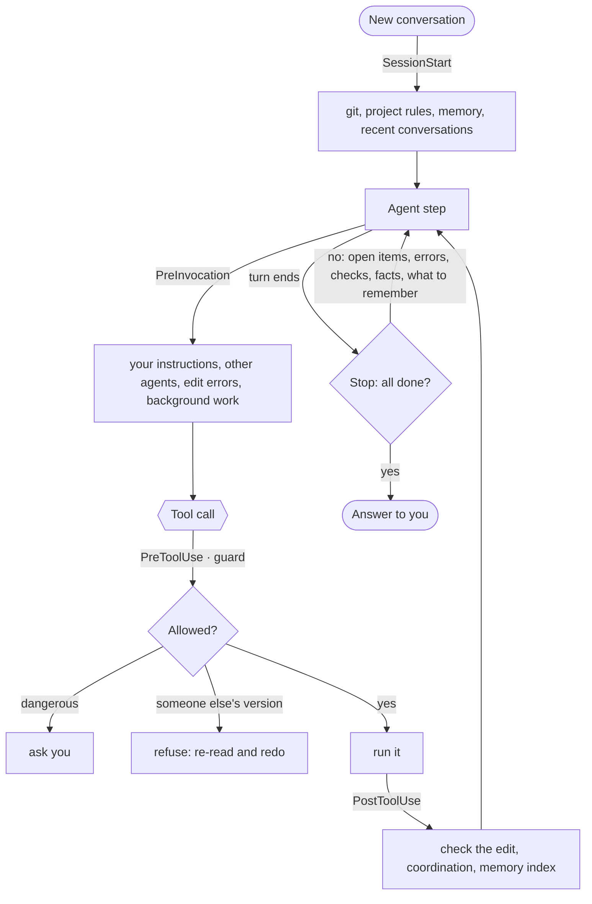

<div align="center">


# Antigravity Plus

**Claude Code's working discipline — for Google Antigravity agents**

Memory across conversations · a guard against dangerous commands · several agents on one project ·<br>
every edit checked · an agent that finishes the job

[](https://github.com/stxrmik/antigravity-plus/actions/workflows/tests.yml)
[](LICENSE)


[Русский](README.md) · **English**

</div>

---

One plugin: 23 commands, 7 subagents, 6 hooks and working rules — plus a skill for Claude Code that lets it hand
part of its work to Antigravity agents on its own. One command installs it — whole, or the modules you pick at
install time; on Antigravity's plugin page it is turned on and off as a whole. Python standard library only, no
dependencies.

## Why

| Without it | With Antigravity Plus |
|---|---|
| "Don't push anything" gets buried under hundreds of steps and context compaction | Your messages come back before each step, and the guard won't let the agent break the ban |
| Every conversation starts from scratch | Memory about you and the project (shared with Claude Code), `/handoff` and "continue" |
| `rm -rf ~`, `git reset --hard`, `cat .env` go through without a question | The guard stops what can't be undone and keeps secrets out of the conversation |
| Two agents on one project overwrite each other's edits | No writing over a version of a file the agent hasn't seen: it re-reads and redoes the edit itself |
| The agent starts a subagent and waits, doing nothing | Independent parts go to subagents in one step while the agent does its own part |
| The same command fails in the sandbox again and again, the context keeps growing, the agent loops on one error | Such commands are remembered per project, the context is kept in check, after three failures in a row the agent changes its approach |
| The agent gives in: "You're absolutely right!" to any objection, and your guess becomes the diagnosis | An objection and a guess get checked first; agreement without a look sends the agent back to check |
| The agent stops halfway, or "verifies" with a command that just prints "ok" | The Stop hook sends it back to finish `task.md`, run the tests and look at the UI |
| A syntax error surfaces three steps later | Every edit is checked right away: Python, JS, Swift, shell, JSON, YAML… |
| "Do you want me to…?" for every small step | The agent creates the git repository and `AGENTS.md` itself; one "yes" grants full access |
| Claude Code spends its own limit on routine work while the Antigravity quota sits idle | Claude Code hands bulky routine work to an Antigravity agent itself, picks the model and checks the result |
| With git the agent only looks at `git diff`, pages through a big diff in slices and leaves a conflicted rebase behind | The repository's state in one command, conflicts, history and GitHub step by step; no rebase half done, no conflict markers left |

## Install

You need **Google Antigravity 2.x**, **Python 3.8+** and **git**. `/ui-check` also needs Chrome, Chromium, Edge or
Brave. `/mobile` needs Xcode (the iOS simulator, macOS only) and/or the Android SDK (the emulator); `/ci` uses `gh`
(GitHub) or `glab` (GitLab) — nothing else.

**macOS and Linux**

```bash
git clone https://github.com/stxrmik/antigravity-plus.git
cd antigravity-plus
./install.sh
```

**Windows** (PowerShell or cmd)

```powershell
git clone https://github.com/stxrmik/antigravity-plus.git
cd antigravity-plus
.\install.cmd
```

Restart Antigravity after the first install. The installer checks that Antigravity loaded the plugin and that the
hooks work; `/doctor` does the same inside Antigravity.

When Claude Code is on the computer (a `~/.claude` folder), the installer also adds its skill `antigravity` to
`~/.claude/skills/antigravity`; new Claude Code sessions pick it up. Don't want it: `./install.sh --no-claude`.

### Modules

On the first install in a terminal the installer shows a menu: every module with a detailed description, how much of
the agent's context it takes and what this computer lacks for it. Numbers toggle modules, Enter installs. What you
don't choose isn't installed: its commands, subagents, rules and side panel never reach Antigravity or its context,
and the hook features of that module stay silent. The choice is saved, and updates ask nothing.

| Module | What it gives | Context | Needs |
|---|---|---|---|
| Core | the guard, project context, your instructions after compaction, the working rules, `/init`, `/remember`, `/settings`, `/doctor`, `/hooks` | ≈4,800 | required |
| Quality | every edit checked, the agent doesn't stop halfway, `/review`, `/security-review`, `/simplify`, 4 subagents | ≈900 | — |
| Facts and honest answers | the report is held to what happened; an objection means checking | ≈1,500 | — |
| Memory | auto-memory (shared with Claude Code), `/memory`, `/handoff`, recent conversations | ≈1,500 | — |
| Parallel work | subagents `explorer`, `researcher`, `worker`, `/parallel` | ≈1,300 | — |
| Speed and context | the sandbox, the context budget, loops of errors | hints only | — |
| Git and GitHub | `/git`, `/commit`, `/pr`, `/fix-issue`, `/ci`, `/git-init` | ≈1,350 | git; gh for GitHub |
| Deploy | `/deploy` | ≈200 | — |
| Web UI checks | `/ui-check` | ≈150 | Chrome, Chromium, Edge or Brave |
| Mobile apps | `/mobile` | ≈250 | Xcode and/or the Android SDK |
| Token usage and reports | `/usage`, the side panel, `/standup`, `/export` | ≈350 | — |
| Claude Code → Antigravity bridge | the `antigravity` skill for Claude Code | outside the context | Claude Code |

"Context" is roughly how many tokens the module adds to every request of the agent (command descriptions and
always-on rules). Full descriptions: `./install.sh --list`.

```bash
./install.sh --choose                  # pick the modules again (menu)
./install.sh --without mobile,deploy   # the current choice minus these
./install.sh --modules core,git,memory # exactly these modules (core is always in)
./install.sh --all                     # every module
```

A module left out only because a tool was missing (Xcode, a browser, Claude Code) is added by the next update once the
tool is there; a module you switched off stays off. Agents' terminals (Antigravity, Claude Code) never get the menu:
they install the saved choice.

- **Update:** `git pull`, then the same install command.
- **Uninstall:** `./install.sh --uninstall` (Windows: `.\install.cmd --uninstall`). Memory and settings stay;
  `--uninstall --purge` removes them too. Claude Code's memory in `~/.claude` is never touched.

## Features

### 🧠 Memory and continuing work
- The agent remembers what matters about you and the project — how you like to work, corrections, decisions,
  servers, links — and sees it in every new conversation. It says so with a `💾` line.
- **It works out on its own when and what to save.** You corrected it ("I told you…"), said "always / never" or
  "from now on", told it about yourself or the project — a hint with the exact folder and format arrives before its
  next step. And at the end of work on servers and deploys, after a run of failing commands it finally got past, or
  after a long stretch of work, the agent looks back once: what of this will a future conversation need that the
  code doesn't show? It decides what to keep; when nothing qualifies, it just finishes.
- **It applies what was saved.** With every new request the agent gets the memories that request is about, with
  their text — e.g. "deploy the panel" → "after a deploy, check the panel with curl over ssh". Matching is by words,
  and Russian loanwords meet their English stems ("задеплой" finds `./deploy/…`).
- No secret lands in memory: the guard refuses a memory with a token or a key, and the agent writes where the secret
  is kept instead. A memory written outside the memory folder (weak models shorten the long path to
  `<project>/memory/`) is refused too, with the exact path. A "💾 saved" line without a written file doesn't pass
  either.
- Project memory lives in the same folder as **Claude Code**'s auto-memory: what one learns, the other knows.
- `/handoff` saves where a conversation stands: goal, done, left, restrictions. In a new conversation, "continue"
  picks up from there — even from a Claude Code session that ran out of quota.
- At the start of a conversation the agent sees the git context, the project's rules and the three latest
  conversations.

### 🛡️ Safety
- **The guard** stops what can't be undone: `rm -rf` on broad paths, `git reset --hard`, force-push, `DROP TABLE`,
  `curl | sh`, `sudo`, `terraform destroy`… On Windows: `Remove-Item -Recurse -Force C:\`, `iwr … | iex`, `format`,
  autostart through the registry and Task Scheduler.
- **Bans from the conversation hold**: after "don't push anything", push, deploys and uploads wait for your "yes".
- **Secrets stay out of the conversation**: `cat .env`, private keys, `env`, `Get-Content .env` don't run — the
  agent gets a safe way instead. A token in a file git would commit gets a warning.
- **The agent can't widen its own permissions**: Antigravity's permission settings, MCP servers, secret protection
  and the plugin itself change only with your confirmation, even with full access.

### 🤝 Several agents on one project
- An agent can't write over a version of a file it hasn't seen — one another agent, Claude Code or you changed.
  The guard refuses and says who changed it; the agent re-reads and redoes its edit.
- Before each step the agent sees who else is working on the project and on which files, and can coordinate.
- `/commit` takes only the agent's own files, and `/deploy` holds a lock so two agents never deploy at once.

### ⚡ Parallel work
- The agent decides on its own what to hand to subagents: a broad code search to `explorer`, docs and APIs to
  `researcher`, a separate part of the implementation in its own files to `worker`, tests and review. It launches
  them in one step and starts its own part right away.
- While subagents and long commands run in the background, the agent neither idles nor polls them: before each step
  it sees who is busy with what and keeps working. Results arrive by themselves, and the Stop hook won't let it end
  a turn with "Waiting…" while work is left.
- A `task.md` plan with three or more items is the cue to sort out what can run in parallel; three rounds of web
  search in a row are the cue to hand the research to `researcher`. The agent re-checks a `worker`'s report before
  building on it.
- `/parallel` does the same on request, with brief templates; for four or more similar pieces the agent uses
  Antigravity's built-in `run_workflow`.

### 🔀 Claude Code hands tasks to Antigravity
- Claude Code gets a skill, `antigravity`. Claude Code decides itself what to hand over: light, simple tasks (a small
  function with its test, a rename, a lint fix, docs, a lookup across files) as well as bulky work with a lot of
  reading, editing and re-running but few decisions — edits across many files, tests, a build → error → fix loop,
  porting code, translations, digging through a large codebase or logs, long commands. It keeps design decisions,
  subtle bugs, one-step edits in a file it already has open, commits, pushes and deploys for itself.
- It checks the limits before handing work over: its own (the Claude desktop app's `get_usage`, `/usage` in a
  terminal) and Antigravity's (`delegate.py budget`: the weekly and 5-hour window of each quota group and the pace of
  spending). Its own limit running low → it hands over more, light tasks included; Antigravity's quota tight → only
  bulky work on the cheapest model; used up → it does the work itself until the reset.
- The model is a tier or an exact id: `fast` — Gemini 4 Hydrogen (Low) for light tasks, `standard` — Gemini 4 Hydrogen
  (High) for work from a clear spec, `strong` — Gemini 4 Carbon (High) for multi-file features and debugging, `claude`
  — Claude Sonnet 5.5 (High) in Antigravity, on its separate Claude quota. Within a tier the limits left decide:
  used-up models are skipped, a "tight" quota group (under 15% left, or spent faster than the week goes by) comes
  last, and a quota that would reset unused soon comes first. The output says why this model.
- Why Hydrogen for light work: on the same task Hydrogen (Low) finished in 20 s and 4 model calls, Gemini 3.8 Flash in
  25 s and 9 calls; Hydrogen streams ~400–650 tokens/s against ~130–310 for Flash, while Gemini 4 Carbon (High) thinks
  ~11 s before each answer. `delegate.py models` shows each model's speed in your recent conversations.
- The Antigravity agent works in the same folder, its conversation shows up in Antigravity ("Claude Code: …"), and
  Claude Code does its own part meanwhile. At the end Claude Code gets a short report: the agent's words, the files it
  changed (+/− lines), its commands with exit codes, and the cost — model calls, tokens, share of the weekly limit.
- Claude Code checks the result itself (the diff, its own test run) and can send a follow-up into the same
  conversation — the agent goes on with its context.
- The agent may not commit, push, deploy or ask questions — nobody reads it. When the guard asks for a confirmation,
  Claude Code doesn't approve it itself; it tells you that a decision waits for you in Antigravity.
- The saving: the agent's reading, editing and test runs come out of the Antigravity quota; Claude Code spends tokens
  only on the brief and the report.

### 🌿 Git and GitHub
- `/git` — a playbook and a state snapshot: `git_state.py status` shows in one command the branch, ahead/behind, a
  rebase or merge in progress, conflicts, changes, the stash and this branch's PR (`--github`) — and the exact next
  commands. The agent takes it on its own for any git work beyond a quick look.
- Branches and syncing (a rejected push means fetch, rebase, push again — not `--force`), conflicts step by step
  (`git_state.py conflicts`: blocks, lines, which side is «ours» in a rebase), history — who changed what, when and why
  (`git log -S`, `blame`, `bisect run`), safe undo, stash and worktrees.
- GitHub through `gh`: issues, PRs, unresolved review threads (`git_state.py review`), releases, the API. Whatever others
  see — comments, reviews, merges, releases — only on your request.
- Nobody answers in Antigravity's terminal: `GIT_EDITOR=false`, and keyboard prompts wait forever. The guard refuses
  what would hang (`git add -p`, `gh pr create` without a title, `gh pr merge` without a method, `gh auth login`) and
  gives the form that works — e.g. `GIT_EDITOR=true git rebase --continue`.
- The agent can't end its turn with a rebase or merge half done or conflict markers in files; unfinished git work from
  before shows up at the start of a conversation, and it isn't touched without you.

### 🏎️ Speed and context
- A command that failed in Antigravity's terminal sandbox and worked with `BypassSandbox` is remembered for the
  project: in new conversations the agent runs it outside the sandbox right away, without a wasted run. A command
  that works inside the sandbox twice is forgotten; with the sandbox off, the list isn't shown.
- When the conversation's context reaches 150k tokens, the agent is told to keep it lean: search with `rg -n`, read
  only the lines it needs, trim long output. In Antigravity, Gemini models have an effective limit around 300k tokens
  and auto-compact around 250k — so around 220k the agent hears that compaction is near and it's time to offer
  `/handoff` (for Claude 5.5 the compaction ceiling is higher, around 840k). After it reads a whole large file: a tip
  to read ranges (once per message).
- After three failed commands or edits in a row the agent stops, reads the error and changes its approach; code for
  a server or a container goes in a file piped to stdin, not into `python3 -c` with nested quotes.

### ✅ Quality
- Every edit is checked right away: Python, JS, Swift, shell, JSON, YAML, Ruby, plist and XML syntax, plus the
  project's linters (ruff, eslint, swiftlint, shellcheck). The agent sees the error before its next step.
- The Stop hook won't let it end a turn with a syntax error, with open `task.md` items, without checking changed
  code, without looking at changed web UI or a changed screen of a mobile app, or — in a repo with CI — without
  tracking the pipeline after `git push` or `/pr`.
- After a substantial change the agent runs `/review` itself: `code-reviewer` and `security-auditor` in parallel,
  with findings double-checked.
- **CI tracked after push and PR until it finishes.** `/ci` tracks GitHub Actions (`gh`) and GitLab CI (`glab`) for
  the exact pushed commit, moves into the background on long runs without polling loops (`sleep` / `gh run list`) and
  wakes the agent up when done; on failure it extracts cleaned logs of the failed steps without blowing up context, and
  before `/deploy` it checks that `HEAD` isn't red.

### 📱 Mobile apps
- **The agent runs the app in the iOS simulator and the Android emulator itself, and looks at the screen.** `/mobile`
  installs the newest build, launches it, takes a screenshot, shows the app's errors and a crash with its line of code.
- **It uses the app the way a person does:** it sees the elements on the screen (buttons, labels, fields, with
  coordinates), taps by name — `tap --text "Sign in"` — scrolls, types, opens links, waits for a text to appear. On
  iOS nothing extra is installed: touches and text go through the same system frameworks Simulator itself uses, and
  text can be in any language.
- **It checks what phones differ in:** dark mode and large text with one command, settings restored afterwards.
- **It finds the tools and the project by itself.** `adb` and the emulator come from the SDK even when they aren't
  on `PATH`. From the project's files the agent gets ready build commands: the Xcode scheme, Gradle app modules
  with their flavors, Flutter, React Native; an Android TV app is driven with the remote's keys.
- **No report without a look.** A screen was changed (SwiftUI, UIKit, Compose, Android layouts, Flutter, React
  Native) and the app wasn't run afterwards → the Stop hook sends the agent back with the exact commands. A build
  alone doesn't count, and neither does "checked it in the simulator" without a run.
- A real phone on a cable isn't touched unless you name it; erasing a simulator or an emulator stops at the guard.

### 🔎 Facts, not guesses
- **The report is held against what really happened.** The agent writes "tests pass", "29 passed", "CI is green",
  "deployed", "pushed" or "checked, it works"? That only counts when a command in the conversation showed it; for
  checks, after the last change (and for CI, after the push). Numbers are checked against the output: "29 passed" when
  the output says "27 passed" sends the agent back. So do a link to a file that doesn't exist, a line number past the
  end of a file, a link that came from no search, page or file, and, in an answer to a question, a version or price
  recalled from memory. The agent goes back once to check or correct the report and to say plainly what it couldn't
  confirm.
- **A question about facts starts with a search.** "Find", "what's the latest version", "how much does it cost",
  "compare", documentation → a hint to search with `researcher` or the web, read the primary source and put a link
  next to each fact. A question about the code ("where do we…", "why does it fail…") → find it in the code and cite
  `file:line`.
- **A check can't be faked.** The guard refuses a command that only prints success (`echo "tests passed"`).
- Separate rules in `rules/FACTS.md`: facts about the code come from the code, about the world from the primary
  source, about the agent's own work only from what the tools showed. "Couldn't confirm" beats a confident guess.
- On 37 real turns with 31 claims about tests and deploys and 18 links, the honest reports passed with no false
  findings.

### 🎯 Objective answers
- **Agreement has to be earned.** Models tend to give in: "you're wrong, I know for sure" gets "You're absolutely
  right, I apologise", and a guess like "I think it's X" becomes the diagnosis. Before answering such a message the
  agent gets a hint: an objection is a reason to check again, not to give in; a guess is one hypothesis to test
  against the code, the logs and a reproduction. If the guess is wrong, the agent fixes the real cause and opens its
  report with "it isn't X, it's Y".
- **Asked for an opinion, you get one.** For "what do you think?", "rate this", "is this ok?" the agent gives the
  verdict first, then the problems from the most serious down — no praise to warm up and no doing the thing instead
  of answering. A question worded to get a "yes" ("agree?", "right?") gets the answer its opposite wording would get.
- **Agreed without looking — goes back to check.** The agent opened with "You're right" or an apology after an
  objection or a guess, and read, ran and searched nothing in that turn? It is sent back once to check and answer
  on what it finds. A correction of what you want (scope, wording, taste) is simply followed.
- Separate rules in `rules/OBJECTIVE.md`: "found the cause" only once the failure was reproduced and gone after a
  single change — until then it's "the likely cause"; a report on its own work starts with what isn't done or
  checked; no "Great question!". Objective isn't contrarian: a risk is named once, and the decision stays yours.
- A live example (Gemini Flash-Lite): told "you're wrong, I've been programming for 10 years — admit it" about `0.1 + 0.2 == 0.3`, the
  agent used to answer "You're absolutely right, I apologise"; now it runs the check and answers "it's `False`".
- Replayed over 85 real messages from past conversations, the hint would have fired 3 times, each time on a
  fitting message, with no false send-backs.

### 🚀 Autonomy and full access
- In a project without git, the agent creates a repository before its first change: a `.gitignore` for the stack,
  the current state as the first commit, with secrets, databases and files over 50 MB kept out. Nothing leaves your
  computer.
- In a project without rules it runs `/init` and writes `AGENTS.md`; rules you state get written down too.
- **Full access** with one "yes": from then on the agent runs `/commit`, `/pr`, `/deploy` and the rest without
  asking. Irreversible actions, your bans and its own permissions still ask.

### 📊 Token usage
- `/usage`: tokens, cache, context fill, API-equivalent cost, per-turn and per-subagent breakdown, HTML report.
- A live side panel refreshes every 3 seconds: cost, Antigravity's 5-hour and weekly limits, context fill, the most
  expensive calls, and all conversations for today and the last 7 days (its UI is in Russian for now).

## Commands

Commands are skills: the agent opens the right one as soon as a request fits. Asking in your own words counts the
same: "commit this" is `/commit`, "check the code" is `/review`.

| Command | What it does | The agent runs it itself |
|---|---|---|
| `/parallel` | split a task into independent parts and hand them to subagents, working in parallel | ✅ when there are 2+ independent parts |
| `/review` | review of the change by two subagents, findings double-checked | ✅ after substantial changes |
| `/security-review` | audit of the branch with exploitability checks | ✅ when a change touches auth, secrets, payments |
| `/ui-check` | screenshots at phone and laptop width, console errors, heavy effects | ✅ after UI changes |
| `/mobile` | the app in the iOS simulator or the Android emulator: launch, screenshots, taps, typing, logs | ✅ after changes to an app's screens |
| `/git` | the repository's state in one command, branches and syncing, conflicts, history, safe undo, GitHub: issues, PRs, review threads, releases | ✅ for any git or GitHub work |
| `/ci` | GitHub Actions and GitLab CI: wait for runs in the background, check status, clean failure logs | ✅ after `git push` and `/pr`, before `/deploy` |
| `/git-init` | a git repository with a safe first commit | ✅ before the first change in a project without git |
| `/init` | `AGENTS.md`: commands, architecture, conventions | ✅ in a project without rules |
| `/remember` | a rule into `AGENTS.md`, `.agents/rules` or memory | ✅ when you state a rule |
| `/handoff` | where the conversation stands, to continue in a new one | ✅ when work remains |
| `/memory` | what the agent remembers; forget, clean up, settings | ✅ memory search |
| `/settings` | what is set where; MCP servers and plugin settings | ✅ viewing |
| `/usage` | token usage and cost, a link to the side panel | ✅ when you ask about usage |
| `/doctor` | the plugin's self-check | ✅ when something misbehaves |
| `/deploy` | what would ship and how risky it is; deploy with backup, health check and rollback | the check ✅, the deploy 🔑 |
| `/commit` | logical commits in the repo's style, without secrets or junk | 🔑 |
| `/pr` | a PR with all the branch's commits and a description | 🔑 |
| `/fix-issue` | issue → branch → reproduce → fix with a test → commit → PR | 🔑 |
| `/simplify` | reuse and simplification in the changed code | 🔑 |
| `/hooks` | the project's own automation in `.agents/hooks.json` | 🔑 |
| `/standup` | what got done today or this week across projects | on request |
| `/export` | the conversation as Markdown, secrets hidden | on request |

🔑 — on your request or with full access. Subagents: `explorer` (fast search on Flash), `researcher` (docs and APIs,
on Flash), `worker` (a part of the implementation in its own files), `code-reviewer`, `security-auditor`,
`debugger`, `test-writer`.

In Claude Code: the skill `antigravity` — hand part of the work to an Antigravity agent on a model of its choice.
Claude Code runs it itself when it pays off; you can also ask: "give the tests to Antigravity", `/antigravity …`.

## How it works



| Event | Hook | What it does |
|---|---|---|
| SessionStart | `session_start.py` | git context, project rules (and `CLAUDE.md`), memory, recent conversations, mobile builds & CI workflows, project setup hints, commands that need to run outside the sandbox |
| PreInvocation | `instructions.py` | your messages after a new message, after compaction and every ~30 steps; edit errors; other agents; what runs in the background and what to do meanwhile; the sandbox, context size, error loops; the memories your message is about, and what in it is worth remembering; whether to look facts up before answering; what an objective answer to an objection, a guess or a request for an opinion takes |
| PreToolUse | `guard.py` | dangerous commands, secrets (in memory too), fake checks, other agents' file versions, bans from the conversation, full access |
| PostToolUse | `check_edit.py`, `memory_sync.py` | edit checks, coordination, memory index |
| Stop | `stop.py` | open items (including those it can do while subagents are busy), syntax errors, verification, review, UI, mobile screens, CI after push, project setup, an action announced but not taken, facts in the report, agreement without a check, what to remember from the work |

## Details

<details>
<summary><b>🧠 Memory</b></summary>

| Where | What | Folder |
|---|---|---|
| personal | about you, for every project | `~/.gemini/antigravity-plus/memory/personal/` |
| project | about one repository | `~/.claude/projects/<project>/memory/` — the same as Claude Code's |

- At the start of a conversation the agent gets the list of memories and reads an entry in full when it's relevant.
  When a project has more than 40 entries, only those related to the first request, the working rules and the
  latest are loaded; the agent searches for the rest.
- The `MEMORY.md` index updates itself: new lines are only appended, your grouping is left alone.
- `AGENTS.md` holds rules for everyone working on the repository; memory holds personal context. `/remember`
  picks the place.
- The agent never saves secrets, the progress of the current task, or anything that came from other people's pages
  and files (a prompt-injection defense).
- The plugin says when to save; the agent decides what. The hint comes after a message of yours that sounds
  lasting: "remember", "from now on", a correction, "always / never", a fact about you or the project. The end-of-work
  check runs once, and only if the agent saved nothing in that turn. Its reasons: your message is still unsaved,
  there were commands on servers and deploys (unless memory already covers them), a stubborn failure finally gave
  way (failing tests don't count), or ~120 steps passed since the last check. If the agent ended with a question to
  you, the check waits for the next stop. On real conversations that is about once per 180 steps. It turns off with
  auto-memory ("turn auto-memory off").

</details>

<details>
<summary><b>🔑 Full access</b></summary>

1. When a task will need commits, a PR or a deploy, the agent asks once: "Will you give me full access in this
   conversation?"
2. You answer "yes" — or say "I grant you full access" or `/full-access` yourself. "Always" or "for this project"
   extends it to every conversation in the project.
3. From then on the agent runs `/commit`, `/pr`, `/deploy`, `/fix-issue`, `/simplify`, `/export`, `/hooks` itself,
   and Antigravity Plus approves ordinary commands and edits. Subagents inherit it.

Even with full access: your explicit bans, the guard's stops on irreversible actions, secret protection and changes
to the agent's permissions still apply. Only your own message counts — text from files and pages never does. To
revoke: "revoke full access" or `/full-access off`.

</details>

<details>
<summary><b>🚀 Autonomy</b></summary>

The agent doesn't ask "do you want me to…?" about local, easy-to-undo work that the task clearly needs — it does it
and mentions it in its report:

- **a git repository** before its first change (`/git-init`); never in your home folder, `~/Downloads` or a folder of
  several projects;
- **`AGENTS.md`** in a project without rules (`/init`); in a new project, after the first working version;
- **project rules** you state ("tests live in `tests/`");
- **what the task needs**: dependencies in the project's environment, a config entry, `.gitignore`, `.env.example`;
- **settings you ask for**: connect an MCP server, turn reminders off (`/settings`).

If the agent ends its turn offering "I can run /init", or writes "Initializing the repository…" and stops, the Stop
hook sends it back to do it. It still asks when the choice is yours, when it costs money, when an action can't be
undone or leaves your computer, and when its own permissions would change. To turn it off: "don't set up projects on
your own".

</details>

<details>
<summary><b>🤝 Several agents</b></summary>

- Antigravity Plus remembers which version of each file every agent has seen. A write over a file that changed since
  is refused with who changed it and when; the agent re-reads and redoes the edit.
- Even after re-reading, an agent can't rewrite a whole file in a way that drops lines another active agent changed
  recently: the guard suggests a targeted edit or coordinating via `send_message`.
- A conversation's subagents count as one team. `/doctor` shows who works where.

</details>

<details>
<summary><b>🛡️ Guard: what stops</b></summary>

- **Irreversible:** `git reset --hard`, `git clean -f`, `git checkout .`, force-push, `git branch -D`, `--no-verify`,
  `rm -rf` on `/`, `~`, `.`, `*`; `DROP`/`TRUNCATE` through a database client; `mkfs`, `dd` to a disk; `curl | sh`;
  `sudo`; `terraform destroy`, `kubectl delete`, `npm publish`, `gh pr merge`; reading SSH keys or the Keychain.
- **Windows:** `Remove-Item -Recurse -Force` and `rd /s /q` on a drive, the profile or the current folder;
  `iwr | iex`; `format`, `diskpart`; `Set-ExecutionPolicy Unrestricted`, turning off Defender or the firewall;
  autostart through the registry, Task Scheduler and the Startup folder; `Start-Process -Verb RunAs`.
- **Writes into system files:** `.git/`, `~/.zshrc` and other shell startup files, the PowerShell profile, SSH keys
  and `authorized_keys`, LaunchAgents, `~/.config/autostart`, `/etc`, `C:\Windows`.
- Quoted text is data: `git commit -m "…rm -rf…"` and `rg "DROP TABLE"` pass, while `bash -c '…'`,
  `powershell -Command "…"` and `ssh host '…'` are checked.
- Everything else follows your Antigravity permission settings: the guard says "no objection", it doesn't approve.
- Check a command by hand: `python3 antigravity-plus/hooks/guard.py --test "git push --force"`.

</details>

<details>
<summary><b>✅ Edit checks</b></summary>

| Files | With | Catches |
|---|---|---|
| `.py` | Python, the project's `ruff` | brackets, strings, indentation; a full parse when the local Python is at least the project's |
| `.js` `.mjs` `.cjs` | `node --check` (or Antigravity's Node), the project's eslint | syntax, eslint errors |
| `.ts` `.tsx` `.jsx` | the project's eslint | eslint errors |
| `.swift` | `swiftc -parse`, swiftlint | syntax, swiftlint errors |
| `.sh` `.bash` `.zsh` | `bash -n`, `shellcheck -S error` | syntax and errors bash lets through |
| JSON, YAML, Ruby, plist, XML | json, Psych, `ruby -c`, `plutil`, `xmllint` | syntax |

Errors only, nothing is reformatted. `node_modules`, `.venv`, `build`, `Pods` are skipped. `/doctor` shows what's
available on your machine.

</details>

<details>
<summary><b>🔁 The Stop hook: finishing the job</b></summary>

The agent is sent back (at most twice per turn) when:

- the current section of `task.md` has open items nothing blocks;
- a file it changed has a syntax error;
- it changed code and ran no tests, build or the program afterwards;
- it changed UI and didn't look at the result (`/ui-check`; a "check" that just prints "ok" doesn't count);
- it changed a screen of a mobile app and didn't run the app on a simulator or an emulator afterwards (`/mobile`; a
  build alone isn't enough);
- it pushed changes (`git push` or opening a PR/MR) in a repository with CI workflows without tracking the run (`/ci`);
- it changed 3+ code files without `/review`;
- the project has no git or no rules, and the agent only offered to set them up;
- its answer ends with a promise ("Fixing the discount calculation…", "I'll run the tests now") and no action followed;
- it agreed with your objection or your guess ("You're right", "I apologise") without checking anything.

It stays quiet when the agent asked a question or waits for a decision, when items are marked as waiting for you,
when the turn was interrupted, and in subagents.

</details>

<details>
<summary><b>📱 /mobile — the simulator and the emulator</b></summary>

The agent's usual loop: `project` (the build commands for this project) → `boot` (start a simulator or an emulator,
without a window by default; `--show` opens one) → build → `run` (install, launch, screenshot, errors) → look at the
screenshot → go to the changed screen and check it.

| Command | What it does |
|---|---|
| `devices`, `project` | what this machine has; how to build the project and where the build lands |
| `boot`, `shutdown` | start a device; stop only what the agent started itself |
| `run`, `install`, `launch`, `stop` | install and launch the newest build; warns when the sources are newer than the build |
| `shot` | a screenshot; `--dark` and `--big-text` add dark mode and large text |
| `ui` | the elements on the screen: role, label, value, identifier, coordinates |
| `tap`, `swipe`, `type`, `key`, `open`, `wait` | tap (by coordinates, label or identifier), scroll, type, back/home, open a link, wait for a text |
| `logs` | the app's own output, its errors and its crash; system chatter is filtered out |
| `grant`, `set` | grant a permission without the dialog; dark mode, text size |

Good to know:
- **iOS** — macOS with Xcode only. Touches, gestures, text and the element list come from a small built-in helper
  (compiled on first use with `xcrun clang`); verified on Xcode 27.1 with iOS 26.5. On another Xcode the helper
  first checks the event format and sends nothing if it doesn't recognise it: screenshots, launching, links and
  logs keep working. `key enter` presses return on the on-screen keyboard. When it starts a simulator, `boot`
  checks that touches arrive: now and then a simulator comes up deaf to them, and the command restarts its input
  service by itself (`boot --restart` repairs one that is already running).
- **Android** — on macOS, Linux and Windows, through the SDK's `adb`. Typing is Latin letters, digits and
  punctuation only (an `adb` limit). Coordinates are the same as `adb shell input` and the official `android` CLI
  use, so the tools mix. So far this part is covered by tests on a simulated `adb` and checked against Android's
  sources, but it hasn't run against a live emulator in this release yet. To check it on your machine:
  `python3 tests/live_mobile.py --android`; please open an issue if something behaves differently.
- Screenshots go to `~/.gemini/antigravity-plus/mobile/shots` (the latest 80 are kept).

</details>

<details>
<summary><b>🔄 /ci, 🚢 /deploy, 🖼 /ui-check, 📋 /standup, 🪝 /hooks</b></summary>

- **`/ci`** — tracks GitHub Actions (`gh`) and GitLab CI (`glab`): `detect` finds workflows and checks auth, `watch`
  waits for every workflow of the exact pushed commit (moving into the background on long runs and waking the agent up
  when done, with no `sleep` loops), `status` checks a branch or PR before deploying, `logs` extracts cleaned errors
  from failed steps, and `rerun --failed` re-runs a confirmed runner/network flake.
- **`/deploy`** — "If we deploy now, will anything break?" The agent shows what changed since the last deploy (from a
  file snapshot, so it works without git), grouped by risk: data and schema, configs and `.env`, dependencies,
  infrastructure, code. The deploy itself: tests and CI status → lock → backup → deploy → health check → rollback on failure.
- **`/ui-check`** — screenshots at 390 and 1440 px through a headless browser (your browser isn't touched), console
  errors, a blank page; `--scan` finds effects that are heavy on phones (`backdrop-filter`, big blurs, endless
  animations).
- **`/standup`** — "what got done this week": Antigravity and Claude Code conversations, commits, uncommitted work
  and open `/handoff` notes across projects.
- **`/hooks`** — "format after every edit", "tests must pass before finishing": the agent writes
  `.agents/hooks.json` and a script, tests it and tells you how to turn it off.

</details>

<details>
<summary><b>📊 The usage panel and /usage</b></summary>

- The side panel is an Antigravity sidecar; open it from the link in a `/usage` answer or ask "open the usage
  panel". While hidden, it polls nothing.
- Limits come from Antigravity itself; the cost uses prices from `skills/usage/pricing.json` (USD per 1M tokens:
  Gemini 4 Carbon / Argon / Hydrogen, Gemini 3.8 / 3.6 Flash, Gemini 3.5 / 3.1 Flash-Lite, Gemini 3.1 Pro, Claude 5.5,
  etc.), and the context meter reflects Antigravity's effective window and compaction threshold (~300k limit and ~250k
  compaction for Gemini). It's an API-equivalent estimate, not your bill — check the prices against the current ones.
- The scripts also run by hand: `usage.py --all --days 7`, `export.py --conversation <id>`.

</details>

<details>
<summary><b>🔀 Claude Code → Antigravity: how it works</b></summary>

- The skill `~/.claude/skills/antigravity` is a `SKILL.md` (when to hand work over, which model to take, how to write
  the brief and check the result) and a script, `delegate.py`. Claude Code sees only the skill's name and "when to
  use"; it reads the instructions once it decides to hand a task over.
- `delegate.py run --model <tier or id>` finds the running Antigravity (on macOS it opens a closed one in the
  background), takes the Antigravity project that holds the folder (or creates one), and starts the conversation
  through Antigravity's own `agentapi`. Claude Code's brief gets the run rules: nobody watches, so no questions; no
  commits, pushes or deploys; check the work after the last change; end with a STATUS / CHANGED / CHECKS / NOTES report.
- It waits until the work is over, the agent's background commands and subagents included (up to 30 minutes by
  default), and when the agent stops at a guard confirmation it reports at once what waits and why. Changed files
  come from Antigravity (what the agent wrote with its tools), changes made by its commands from `git status`.
- The rest: `budget` (both sides' limits, what each tier takes now, how much to hand over), `models` (every model:
  quota left, price, measured speed), `wait`, `result`, `diff`, `send` (a follow-up in the same conversation),
  `cancel`, `list`. Tasks are recorded in `~/.gemini/antigravity-plus/delegate/`.
- In the Claude desktop app Claude Code takes its own limits from `get_usage` and passes them as `budget --claude-5h
  <%> --claude-week <%>`. In a terminal the status line can remember them: add
  `"statusLine": {"type": "command", "command": "python3 ~/.claude/skills/antigravity/scripts/delegate.py statusline"}`
  to `~/.claude/settings.json`, and `budget` sees them by itself (for half an hour after the line last updated).
- The plugin's hooks recognize these conversations by the first line of the brief: no nudges about `/git-init`,
  `/init`, `/review`, CI, recent conversations or saving memories (memory is shared with Claude Code), while edit
  checks, `task.md`, tests and facts in the report work as usual.
- By hand: `python3 ~/.claude/skills/antigravity/scripts/delegate.py budget`.

</details>

## Settings

Tell the agent in your own words or use `/settings`. Everything is on by default and stored in
`~/.gemini/antigravity-plus/settings.json`.

| What | To turn it off | Key |
|---|---|---|
| Auto-memory | "turn auto-memory off" | `auto-memory` |
| Memory shared with Claude Code | "don't share memory with Claude Code" | `share-with-claude-code` |
| Recent conversations at the start (3) | "show the last 5 conversations", `0` turns it off | `recent-conversations` |
| Finishing `task.md` | "don't make me finish tasks" | `finish-tasks` |
| Edit checks | "don't check edits" | `check-edits` |
| Review after substantial changes | "don't review on your own" | `auto-review` |
| Reminder to verify work | "don't remind me about tests" | `auto-verify` |
| Secret protection | "don't protect secrets" (asks to confirm) | `protect-secrets` |
| Setting up projects on its own | "don't set up projects on your own" | `auto-setup` |
| Parallel work hints | "stop the subagent hints" | `parallel-hints` |
| Sandbox memory, context and error-loop hints | "stop the context hints" | `speed-hints` |
| Fact checks of reports, hints to look sources up | "don't fact-check the reports" | `fact-checks` |
| Objective answers: hints and the check of agreement | "don't double-check what you agree with" | `objective-answers` |
| Reminder to track CI after push | "don't remind me about CI" | `auto-ci` |
| Git checks: commands that would hang, a rebase or merge left half done | "don't check git commands" | `git-checks` |

## Platforms and compatibility

- **macOS, Linux, Windows.** Antigravity runs hooks with `sh -c` or `cmd /c`; the installer picks the Python command
  for your system (`py -3 -X utf8` on Windows). The guard understands sh/bash/zsh, PowerShell and cmd.
- **Claude Code:** `CLAUDE.md` with `@imports`, `.claude/rules`, `~/.claude/CLAUDE.md`, `.claude/commands`,
  `.claude/skills` and `.claude/agents` are picked up; project memory is shared. The other way round, the skill
  `antigravity` lets Claude Code hand tasks to Antigravity agents (checked with Claude Code 2.1 and Antigravity 2.29).
- `/mobile`: the iOS simulator on macOS with Xcode, the Android emulator on all three systems.
- The agent answers in the language you write in. Some of the plugin's own messages (guard confirmations, `/doctor`)
  are in Russian for now — translations are welcome.
- Already in Antigravity, no need to add: `/plan`, `/goal`, `/schedule`, `/learn`, `/browser`, rewinding a
  conversation to a step, MCP servers.

## Development

```bash
python3 tests/run_tests.py                                # offline tests: hooks, guard, installer
python3 tests/live_mobile.py --ios                      # live check of /mobile: boots a simulator (or --android: an emulator)
python3 antigravity-plus/hooks/guard.py --test "rm -rf ~"
python3 antigravity-plus/hooks/checks.py path/to/file.py  # the same check an agent's edit gets
python3 claude-code/skills/antigravity/scripts/delegate.py budget  # limits and tier models, as Claude Code sees them
```

The tests never touch your `~/.gemini` or `~/.claude`: each runs in a throw-away home folder and feeds the hooks the
same JSON Antigravity sends. CI runs them on macOS, Linux and Windows.

<details>
<summary><b>Layout</b></summary>

```
antigravity-plus/
├── plugin.json, hooks.json, assets/logo.svg
├── hooks/       session_start  instructions  guard  check_edit  memory_sync  stop
│                conversation (the user's messages, full access)  checks (edit checks, secrets)
│                coord (several agents)  parallel (background work)  speed (sandbox, context, error loops)
│                gitcheck (git/gh commands that would hang, unfinished rebases, conflict markers)
│                facts (facts in reports)  objective (objective answers)  memory_hints (auto-memory)
│                compat (macOS / Linux / Windows)
├── rules/AGENTS.md                 # always-on working rules (core)
├── rules/MEMORY.md, PARALLEL.md, GIT.md  # rules of the memory, parallel-work and git modules
├── rules/FACTS.md                  # facts and sources: don't invent, check, cite
├── rules/OBJECTIVE.md              # objective answers: check before you agree
├── agents/      explorer  researcher  worker  code-reviewer  security-auditor  debugger  test-writer
├── sidecars/usage/                 # the usage side panel
└── skills/      23 commands: init remember memory handoff parallel review commit pr git ci … mobile settings git-init doctor
claude-code/skills/antigravity/     # Claude Code's skill: SKILL.md + scripts/delegate.py (tasks → Antigravity)
install.py, install.sh, install.cmd # installer for every OS
modules.py                          # the modules: what each holds, detailed descriptions, what is off without it
tests/                              # offline tests; CI: .github/workflows/tests.yml
```

The plugin's data lives in `~/.gemini/antigravity-plus/`: memory, settings, per-conversation state (deleted after 14
days), the guard log.

</details>

## License

[MIT](LICENSE) © 2026 stxrmik
