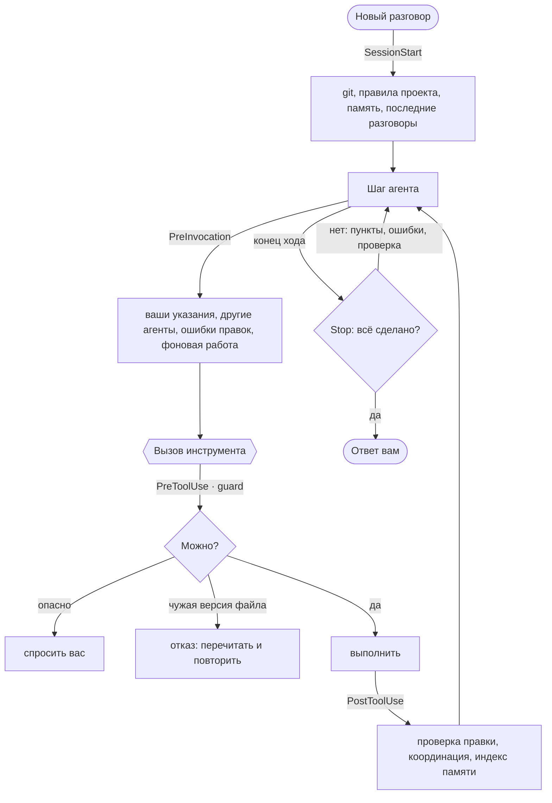

<div align="center">


# Antigravity Plus

**Рабочая дисциплина Claude Code — для агентов Google Antigravity**

Память между разговорами · защита от опасных команд · несколько агентов в одном проекте ·<br>
проверка каждой правки · агент, который доводит работу до конца

[](https://github.com/stxrmik/antigravity-plus/actions/workflows/tests.yml)
[](LICENSE)


**Русский** · [English](README.en.md)

</div>

---

Один плагин: 20 команд, 7 субагентов, 6 хуков и правила работы. Ставится одной командой, включается и выключается
целиком на странице плагинов Antigravity. Только стандартная библиотека Python, без зависимостей.

## Зачем

| Без плагина | С Antigravity Plus |
|---|---|
| Указание «ничего не пушь» тонет через сотни шагов и после сжатия контекста | Перед шагом агент снова видит ваши сообщения, а guard не даст нарушить запрет |
| Каждый разговор начинается с нуля | Память о вас и проекте (общая с Claude Code), `/handoff` и «продолжи» |
| `rm -rf ~`, `git reset --hard`, `cat .env` проходят без вопросов | Guard останавливает необратимое и не выводит секреты в разговор |
| Два агента в одном проекте затирают правки друг друга | Нельзя записать поверх чужой версии файла: агент сам перечитает и повторит |
| Агент запускает субагента и ждёт, ничего не делая | Независимые части уходят субагентам одним шагом, а агент тем временем делает свою |
| Одна и та же команда раз за разом падает в песочнице, контекст разрастается, агент крутит одну ошибку | Такие команды запоминаются по проекту, контекст под присмотром, после трёх неудач подряд агент меняет подход |
| Агент бросает задачу на середине или «проверяет» командой, которая печатает «ок» | Stop-хук вернёт доделать `task.md`, прогнать тесты и посмотреть на вёрстку |
| Синтаксическая ошибка всплывает через три шага | Каждая правка проверяется сразу: Python, JS, Swift, shell, JSON, YAML… |
| На каждую мелочь — «Хотите, чтобы я…?» | Агент сам создаёт git-репозиторий и `AGENTS.md`; одно «да» даёт полный доступ |

## Установка

Нужны **Google Antigravity 2.x**, **Python 3.8+** и **git**. Для `/ui-check` — Chrome, Chromium, Edge или Brave.

**macOS и Linux**

```bash
git clone https://github.com/stxrmik/antigravity-plus.git
cd antigravity-plus
./install.sh
```

**Windows** (PowerShell или cmd)

```powershell
git clone https://github.com/stxrmik/antigravity-plus.git
cd antigravity-plus
.\install.cmd
```

После первой установки перезапустите Antigravity. Установщик сам проверит, что Antigravity загрузил плагин и хуки
работают; внутри Antigravity то же делает `/doctor`.

- **Обновить:** `git pull`, затем та же команда установки.
- **Удалить:** `./install.sh --uninstall` (Windows: `.\install.cmd --uninstall`). Память и настройки остаются;
  `--uninstall --purge` удалит и их. Память Claude Code в `~/.claude` не трогается никогда.

## Возможности

### 🧠 Память и продолжение работы
- Агент сам запоминает важное о вас и проекте: как вы любите работать, поправки, решения, серверы, ссылки — и видит
  это в каждом новом разговоре. Пишет об этом строкой `💾 Запомнил: …`.
- Память проекта — та же папка, что у автопамяти **Claude Code**: что запомнил один, знает и другой.
- `/handoff` сохраняет итог разговора: цель, что сделано, что осталось, ограничения. В новом разговоре «продолжи»
  подхватывает с этого места — даже из сессии Claude Code, если у него кончились лимиты.
- В начале разговора агент видит git-контекст, правила проекта и три последних разговора.

### 🛡️ Безопасность
- **Guard** останавливает необратимое: `rm -rf` широких путей, `git reset --hard`, force-push, `DROP TABLE`,
  `curl | sh`, `sudo`, `terraform destroy`… На Windows — `Remove-Item -Recurse -Force C:\`, `iwr … | iex`,
  `format`, автозапуск через реестр и планировщик.
- **Запреты из разговора соблюдаются**: после «ничего не пушь» push, деплой и загрузка на сервер ждут вашего «да».
- **Секреты не попадают в разговор**: `cat .env`, приватные ключи, `env`, `Get-Content .env` не выполняются —
  агент получает безопасный способ. Токен в файле, который уйдёт в git, — предупреждение.
- **Свои права агент не расширяет**: настройки разрешений Antigravity, MCP-серверы, защита секретов, сам плагин —
  только с вашего подтверждения, даже при полном доступе.

### 🤝 Несколько агентов в одном проекте
- Агент не запишет файл поверх версии, которую не видел: её изменил другой агент, Claude Code или вы. Guard откажет
  и скажет, кто менял; агент перечитает и повторит правку сам.
- Перед каждым шагом агент видит, кто ещё работает в проекте и над какими файлами, и может договориться с ними.
- `/commit` берёт только свои файлы, `/deploy` держит замок: два агента не задеплоят одновременно.

### ⚡ Параллельная работа
- Агент сам решает, что отдать субагентам: широкий поиск по коду — `explorer`, документацию и API — `researcher`,
  отдельную часть реализации в своих файлах — `worker`, тесты и ревью. Запускает их одним шагом и сразу берётся за
  свою часть.
- Пока субагенты и долгие команды работают в фоне, агент не простаивает и не опрашивает их: перед шагом он видит,
  кто чем занят, и продолжает свою работу. Результат приходит сам, а закончить ход со словами «Жду…» при
  оставшейся работе не даст Stop-хук.
- План в `task.md` из трёх и больше пунктов — повод разобрать, что делать параллельно; три раунда веб-поиска
  подряд — повод отдать исследование `researcher`. Отчёт `worker` агент перепроверяет, прежде чем на нём строить.
- `/parallel` — то же по вашей просьбе, с шаблонами брифов; для четырёх и больше однотипных частей агент берёт
  встроенный в Antigravity `run_workflow`.

### 🏎️ Скорость и контекст
- Команда, которая упала в песочнице терминала Antigravity и прошла с `BypassSandbox`, запоминается для проекта:
  в новых разговорах агент сразу запускает её вне песочницы, без холостого прогона. Команда, дважды прошедшая
  внутри песочницы, забывается; при выключенной песочнице список не показывается.
- Когда контекст разговора дорастает до 150 тыс. токенов, агент получает подсказку держать его компактным: искать
  через `rg -n`, читать нужные строки, обрезать длинный вывод. Около 220 тыс. — предупреждение, что скоро сжатие и
  пора предложить `/handoff`. После чтения целого большого файла — совет читать диапазонами (раз на сообщение).
- После трёх неудачных команд или правок подряд агент останавливается, читает ошибку и меняет подход; код для
  сервера или контейнера передаёт файлом через stdin, а не через `python3 -c` с вложенными кавычками.

### ✅ Качество работы
- Каждая правка проверяется сразу: синтаксис Python, JS, Swift, shell, JSON, YAML, Ruby, plist, XML и линтеры
  проекта (ruff, eslint, swiftlint, shellcheck). Агент видит ошибку до следующего шага.
- Stop-хук не даст закончить ход с синтаксической ошибкой, с незакрытыми пунктами `task.md`, без проверки
  изменённого кода и без взгляда на изменённую вёрстку.
- После заметных правок агент сам запускает `/review`: `code-reviewer` и `security-auditor` параллельно,
  с перепроверкой находок.

### 🚀 Самостоятельность и полный доступ
- В проекте без git агент перед первой правкой сам создаёт репозиторий: `.gitignore` под стек, текущее состояние —
  первым коммитом, секреты, базы данных и файлы больше 50 МБ — мимо коммита. В сеть ничего не уходит.
- В проекте без правил сам запускает `/init` и пишет `AGENTS.md`; правило, которое вы сформулировали, — тоже.
- **Полный доступ** одним «да»: дальше агент сам запускает `/commit`, `/pr`, `/deploy` и остальное без вопросов.
  Необратимое, ваши запреты и права агента по-прежнему спрашивают.

### 📊 Расход токенов
- `/usage`: токены, кэш, заполнение контекста, стоимость по API, разбивка по ходам и субагентам, HTML-отчёт.
- Боковая панель «Расход токенов» обновляется каждые 3 секунды: стоимость, 5-часовой и недельный лимиты
  Antigravity, заполнение контекста, дорогие вызовы, все разговоры за сегодня и 7 дней.

## Команды

Команды — это скиллы: агент открывает нужный сам, как только запрос подходит. Просьба своими словами считается
так же: «закоммить» — это `/commit`, «проверь код» — `/review`.

| Команда | Что делает | Агент запускает сам |
|---|---|---|
| `/parallel` | разбить задачу на независимые части и раздать субагентам, работая параллельно | ✅ когда есть 2+ независимые части |
| `/review` | ревью изменений двумя субагентами с перепроверкой находок | ✅ после заметных правок |
| `/security-review` | аудит ветки с проверкой эксплуатируемости | ✅ когда правка трогает авторизацию, секреты, платежи |
| `/ui-check` | скриншоты на ширине телефона и ноутбука, ошибки консоли, тяжёлые эффекты | ✅ после правок вёрстки |
| `/git-init` | git-репозиторий с безопасным первым коммитом | ✅ перед первой правкой в проекте без git |
| `/init` | `AGENTS.md`: команды, архитектура, соглашения | ✅ в проекте без правил |
| `/remember` | правило в `AGENTS.md`, `.agents/rules` или в память | ✅ когда вы формулируете правило |
| `/handoff` | итог разговора для продолжения в новом | ✅ когда работа остаётся |
| `/memory` | что агент помнит; забыть, почистить, настройки | ✅ поиск по памяти |
| `/settings` | где что настроено; MCP-серверы и настройки плагина | ✅ просмотр |
| `/usage` | расход токенов и стоимость, ссылка на боковую панель | ✅ когда вы спрашиваете о расходе |
| `/doctor` | самопроверка плагина | ✅ когда что-то работает не так |
| `/deploy` | что уйдёт на сервер и чем рискованно; деплой с бэкапом, проверкой и откатом | проверку ✅, деплой 🔑 |
| `/commit` | логичные коммиты в стиле репозитория, без секретов и мусора | 🔑 |
| `/pr` | PR со всеми коммитами ветки и описанием | 🔑 |
| `/fix-issue` | issue → ветка → воспроизведение → фикс с тестом → коммит → PR | 🔑 |
| `/simplify` | упрощение и переиспользование в изменённом коде | 🔑 |
| `/hooks` | своя автоматизация проекта в `.agents/hooks.json` | 🔑 |
| `/standup` | что сделано за день или неделю по всем проектам | по просьбе |
| `/export` | разговор в Markdown, секреты скрыты | по просьбе |

🔑 — по вашей просьбе или при полном доступе. Субагенты: `explorer` (быстрый поиск на Flash), `researcher`
(документация и API, на Flash), `worker` (часть реализации в своих файлах), `code-reviewer`, `security-auditor`,
`debugger`, `test-writer`.

## Как это работает



| Событие | Хук | Что делает |
|---|---|---|
| SessionStart | `session_start.py` | git-контекст, правила проекта (и `CLAUDE.md`), память, недавние разговоры, подсказки по настройке проекта, команды вне песочницы |
| PreInvocation | `instructions.py` | ваши сообщения после нового сообщения, сжатия контекста и раз в ~30 шагов; ошибки правок; другие агенты; что работает в фоне и чем заняться пока; песочница, размер контекста, циклы ошибок |
| PreToolUse | `guard.py` | опасные команды, секреты, чужие версии файлов, запреты из разговора, полный доступ |
| PostToolUse | `check_edit.py`, `memory_sync.py` | проверка правки, координация агентов, индекс памяти |
| Stop | `stop.py` | незакрытые пункты (и те, что можно делать, пока заняты субагенты), синтаксические ошибки, проверка, ревью, вёрстка, настройка проекта |

## Подробнее

<details>
<summary><b>🧠 Память</b></summary>

| Где | Что | Папка |
|---|---|---|
| личная | о вас, для всех проектов | `~/.gemini/antigravity-plus/memory/personal/` |
| проект | о конкретном репозитории | `~/.claude/projects/<проект>/memory/` — та же, что у Claude Code |

- В начале разговора агент получает список воспоминаний и читает нужную запись целиком, когда она относится
  к задаче. Если записей в проекте больше 40, загружаются только связанные с первым запросом, правила работы и
  самые свежие; остальное агент найдёт поиском.
- Индекс `MEMORY.md` обновляется сам: новая строка только дописывается, ваша группировка не трогается.
- `AGENTS.md` — правила для всех, кто работает с репозиторием; память — личное и контекст. `/remember` выбирает
  место сам.
- Агент не сохраняет секреты, ход текущей задачи и то, что пришло из чужих страниц и файлов (защита от prompt
  injection).

</details>

<details>
<summary><b>🔑 Полный доступ</b></summary>

1. Когда задаче понадобятся коммиты, PR или деплой, агент один раз спрашивает: «Дадите мне полный доступ в этом
   разговоре?»
2. Вы отвечаете «да» — или сами пишете «даю полный доступ», `/full-access`. «Навсегда» или «для проекта»
   распространяет доступ на все разговоры в проекте.
3. Дальше агент сам запускает `/commit`, `/pr`, `/deploy`, `/fix-issue`, `/simplify`, `/export`, `/hooks`, а обычные
   команды и правки Antigravity Plus одобряет без запросов. Субагенты наследуют доступ.

Остаётся и с полным доступом: ваши явные запреты, остановки guard на необратимом, защита секретов, изменение прав
агента. Засчитывается только ваше сообщение — текст из файлов и страниц никогда. Отозвать: «верни вопросы».

</details>

<details>
<summary><b>🚀 Самостоятельность</b></summary>

Агент не спрашивает «Хотите, чтобы я…?» о том, что явно нужно для задачи, остаётся на компьютере и легко
отменяется, — делает сам и упоминает в отчёте:

- **git-репозиторий** перед первой правкой (`/git-init`). Домашнюю папку, `~/Downloads` и папки с несколькими
  проектами не трогает;
- **`AGENTS.md`** в проекте без правил (`/init`), в новом проекте — после первой рабочей версии;
- **правила проекта**, которые вы сформулировали («тесты лежат в `tests/`»);
- **то, что нужно задаче**: зависимости в окружение проекта, строку в конфиге, `.gitignore`, `.env.example`;
- **настройки по вашей просьбе**: подключить MCP-сервер, выключить напоминания (`/settings`).

Если агент всё же закончил ход предложением «могу запустить /init» или написал «Инициализирую репозиторий…» и
остановился, Stop-хук вернёт его сделать это. Спрашивает он, когда выбор за вами, когда это стоит денег, когда
действие необратимо или уходит наружу и когда меняются права агента. Выключить: «не настраивай проекты сам».

</details>

<details>
<summary><b>🤝 Несколько агентов</b></summary>

- Antigravity Plus помнит, какую версию каждого файла видел каждый агент. Запись поверх изменившегося файла
  отклоняется с объяснением, кто и когда его менял; агент перечитывает и повторяет правку.
- Даже перечитав файл, агент не перезапишет его целиком так, чтобы пропали строки, которые недавно менял другой
  активный агент: guard предложит править точечно или договориться через `send_message`.
- Субагенты одного разговора — одна команда. Сводка «кто где работает» — в `/doctor`.

</details>

<details>
<summary><b>🛡️ Guard: что останавливается</b></summary>

- **Необратимое:** `git reset --hard`, `git clean -f`, `git checkout .`, force-push, `git branch -D`, `--no-verify`,
  `rm -rf` на `/`, `~`, `.`, `*`; `DROP`/`TRUNCATE` через клиент БД; `mkfs`, `dd` на диск; `curl | sh`; `sudo`;
  `terraform destroy`, `kubectl delete`, `npm publish`, `gh pr merge`; чтение ключей SSH и Keychain.
- **Windows:** `Remove-Item -Recurse -Force` и `rd /s /q` на диск, профиль или текущую папку; `iwr | iex`;
  `format`, `diskpart`; `Set-ExecutionPolicy Unrestricted`, отключение Defender и брандмауэра; автозапуск через
  реестр, планировщик и папку Startup; `Start-Process -Verb RunAs`.
- **Запись в системное:** `.git/`, `~/.zshrc` и другие стартовые файлы оболочки, профиль PowerShell, SSH-ключи и
  `authorized_keys`, LaunchAgents, `~/.config/autostart`, `/etc`, `C:\Windows`.
- Текст в кавычках — данные: `git commit -m "…rm -rf…"` и `rg "DROP TABLE"` проходят, а `bash -c '…'`,
  `powershell -Command "…"` и `ssh host '…'` проверяются.
- Всё остальное идёт по вашим настройкам разрешений Antigravity: guard отвечает «нет возражений», а не одобряет.
- Проверить команду вручную: `python3 antigravity-plus/hooks/guard.py --test "git push --force"`.

</details>

<details>
<summary><b>✅ Проверка правок</b></summary>

| Файлы | Чем | Что ловит |
|---|---|---|
| `.py` | Python, `ruff` проекта | скобки, строки, отступы; полный разбор — если версия Python не ниже проектной |
| `.js` `.mjs` `.cjs` | `node --check` (или Node из Antigravity), eslint проекта | синтаксис, ошибки eslint |
| `.ts` `.tsx` `.jsx` | eslint проекта | ошибки eslint |
| `.swift` | `swiftc -parse`, swiftlint | синтаксис, ошибки swiftlint |
| `.sh` `.bash` `.zsh` | `bash -n`, `shellcheck -S error` | синтаксис и ошибки, которые bash пропускает |
| JSON, YAML, Ruby, plist, XML | json, Psych, `ruby -c`, `plutil`, `xmllint` | синтаксис |

Только ошибки, ничего не переформатируется. `node_modules`, `.venv`, `build`, `Pods` пропускаются. Что доступно на
вашей машине, показывает `/doctor`.

</details>

<details>
<summary><b>🔁 Stop-хук: доводить до конца</b></summary>

Агент возвращается доделывать (не больше двух раз за ход), когда:

- в текущем разделе `task.md` остались пункты, которые ничто не блокирует;
- в изменённом файле есть синтаксическая ошибка;
- код изменён, а тесты, сборка или сама программа после этого не запускались;
- изменена вёрстка, а на результат не посмотрели (`/ui-check`; «проверка», которая печатает «ок», не считается);
- изменено 3+ файла кода без `/review`;
- проект без git или без правил, а агент только предложил их создать.

Хук молчит, если агент задал вопрос или ждёт решения, если пункты помечены «— ждёт вашего решения», если ход
прерван и в субагентах.

</details>

<details>
<summary><b>🚢 /deploy, 🖼 /ui-check, 📋 /standup, 🪝 /hooks</b></summary>

- **`/deploy`** — «Если сейчас задеплоить, ничего не сломается?» Агент сам покажет, что изменилось с прошлого
  деплоя (по снимку файлов, поэтому и без git), с разбивкой по риску: данные и схема БД, конфиги и `.env`,
  зависимости, инфраструктура, код. Сам деплой: тесты → замок → бэкап → деплой → проверка здоровья → откат при сбое.
- **`/ui-check`** — скриншоты на 390 и 1440 px через headless-браузер (ваш браузер не трогается), ошибки консоли,
  пустая страница; `--scan` ищет тяжёлые для телефона эффекты (`backdrop-filter`, большие размытия, бесконечные
  анимации).
- **`/standup`** — «что сделано за неделю»: разговоры Antigravity и Claude Code, коммиты, незакоммиченное,
  открытые заметки `/handoff` по всем проектам.
- **`/hooks`** — «после каждой правки форматируй», «перед завершением тесты должны проходить»: агент пишет
  `.agents/hooks.json` и скрипт, проверяет его и говорит, как выключить.

</details>

<details>
<summary><b>📊 Панель «Расход токенов» и /usage</b></summary>

- Боковая панель — сайдкар Antigravity; открывается ссылкой из ответа `/usage` или просьбой «открой панель
  расхода». Пока панель скрыта, она ничего не опрашивает.
- Лимиты берутся у самого Antigravity, стоимость — по ценам из `skills/usage/pricing.json` (USD за 1M токенов).
  Это оценка стоимости через API, а не ваш счёт; цены стоит сверить с актуальными.
- Скрипты можно запускать и вручную: `usage.py --all --days 7`, `export.py --conversation <id>`.

</details>

## Настройки

Скажите агенту своими словами или используйте `/settings`. Всё включено по умолчанию и хранится в
`~/.gemini/antigravity-plus/settings.json`.

| Что | Как выключить | Ключ |
|---|---|---|
| Автопамять | «выключи автопамять» | `auto-memory` |
| Память, общая с Claude Code | «не делись с Claude Code» | `share-with-claude-code` |
| Недавние разговоры в начале (3) | «показывай 5 последних разговоров», `0` — выключить | `recent-conversations` |
| Доделывать `task.md` | «не заставляй доделывать задачи» | `finish-tasks` |
| Проверка правок | «не проверяй правки» | `check-edits` |
| Ревью после заметных правок | «не запускай ревью сам» | `auto-review` |
| Напоминание проверить работу | «не напоминай про тесты» | `auto-verify` |
| Защита секретов | «не защищай секреты» (с подтверждением) | `protect-secrets` |
| Самостоятельная настройка проектов | «не настраивай проекты сам» | `auto-setup` |
| Подсказки о параллельной работе | «не подсказывай про субагентов» | `parallel-hints` |
| Память песочницы, подсказки о контексте и циклах ошибок | «не подсказывай про контекст» | `speed-hints` |

## Платформы и совместимость

- **macOS, Linux, Windows.** Antigravity запускает хуки через `sh -c` или `cmd /c`; установщик подбирает команду
  Python для вашей системы (на Windows — `py -3 -X utf8`). Guard понимает sh/bash/zsh, PowerShell и cmd.
- **Claude Code:** `CLAUDE.md` с `@импортами`, `.claude/rules`, `~/.claude/CLAUDE.md`, `.claude/commands`,
  `.claude/skills` и `.claude/agents` подхватываются; память проекта общая.
- Агент отвечает на языке ваших сообщений. Часть служебных сообщений плагина (подтверждения guard, `/doctor`) пока
  на русском.
- Уже есть в самом Antigravity, ставить не нужно: `/plan`, `/goal`, `/schedule`, `/learn`, `/browser`, откат
  разговора к шагу, MCP-серверы.

## Разработка

```bash
python3 tests/run_tests.py                              # офлайн-тесты: хуки, guard, установщик
python3 antigravity-plus/hooks/guard.py --test "rm -rf ~"
python3 antigravity-plus/hooks/checks.py path/to/file.py  # та же проверка, что после правки агентом
```

Тесты не трогают ваши `~/.gemini` и `~/.claude`: каждый идёт во временной домашней папке и подаёт хукам тот же
JSON, что и Antigravity. CI прогоняет их на macOS, Linux и Windows.

<details>
<summary><b>Структура</b></summary>

```
antigravity-plus/
├── plugin.json, hooks.json, assets/logo.svg
├── hooks/       session_start  instructions  guard  check_edit  memory_sync  stop
│                conversation (сообщения пользователя, полный доступ)  checks (проверки, секреты)
│                coord (несколько агентов)  parallel (фоновая работа)  speed (песочница, контекст, циклы ошибок)
│                compat (macOS / Linux / Windows)
├── rules/AGENTS.md                 # всегда включённые правила работы
├── agents/      explorer  researcher  worker  code-reviewer  security-auditor  debugger  test-writer
├── sidecars/usage/                 # боковая панель «Расход токенов»
└── skills/      20 команд: init remember memory handoff parallel review commit pr … settings git-init doctor
install.py, install.sh, install.cmd # установщик для всех систем
tests/                              # офлайн-тесты, CI: .github/workflows/tests.yml
```

Данные плагина — `~/.gemini/antigravity-plus/`: память, настройки, состояние разговоров (удаляется через 14 дней),
журнал guard.

</details>

## Лицензия

[MIT](LICENSE) © 2026 stxrmik
